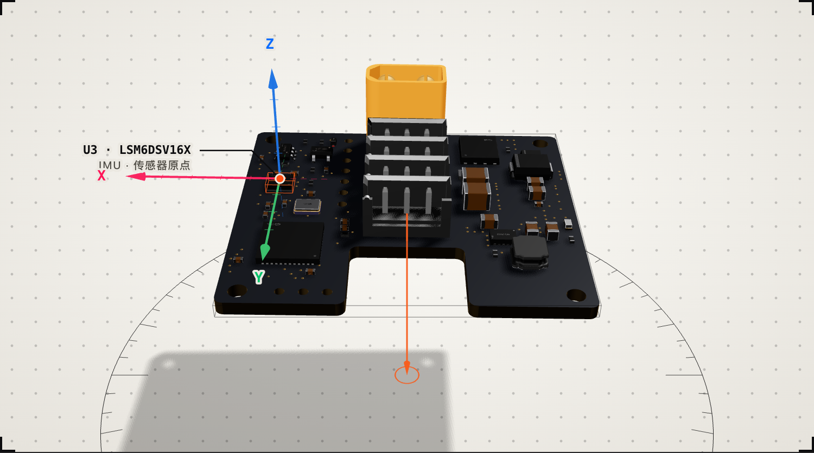
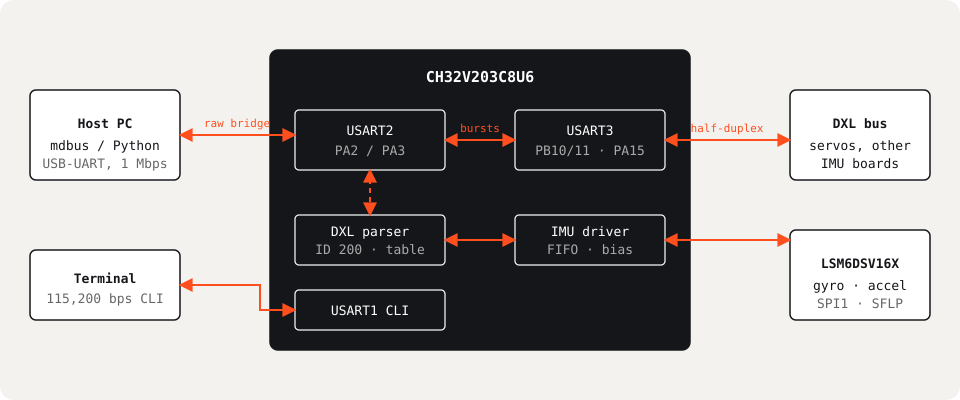

# dxl_imu_firmware

[English](README.md) · [简体中文](README.zh-CN.md)

    

Firmware for the DXL IMU/power board: a WCH CH32V203C8U6 with an ST LSM6DSV16X IMU, speaking Dynamixel
Protocol 2.0. It reports gyro rates and an on-chip sensor-fusion attitude on a Dynamixel bus, and bridges a
USB-UART to that bus.

<p align="center"></p>

## Features

- Dynamixel Protocol 2.0 device (default ID 200, 1 Mbps); IMU sample at address 124: gyro (int16 ×3) and
  SFLP quaternion (half precision ×3).
- Gyro and accelerometer range, sensor rate and fusion rate configurable over the bus and stored in flash.
- Diagnostics block, persistent two-slot configuration (ID, baud rate, IMU parameters).
- Raw soft bus: a USB-UART on USART2 is bridged unchanged to the physical DXL bus, with the bus traffic mirrored
  back, and the board's own ID reachable on the same line.
- 115,200 bps text maintenance port on USART1, active at the same time.

## Status

<p align="center"></p>

| | |
|---|---|
| Version | `0x020B` (tag `firmware-20261006-0x020b`); previous release `0x020A` |
| MCU / IMU | CH32V203C8U6 (8 MHz crystal) / LSM6DSV16X |
| Defaults | ID 200, 1,000,000 bps; ±500 dps, ±2 g, 240 Hz |
| Soft bus | USART2, PA2 (TX) / PA3 (RX), 1,000,000 bps 8N1 |
| Text CLI | USART1, PA9 (TX) / PA10 (RX), 115,200 bps 8N1 |
| Host tests | 7/7 pass |

What has been tested, and what has not: [docs/validation.md](docs/validation.md).

## Build

The Windows build uses the compiler of the official [MounRiver Studio 2](https://www.mounriver.com/download)
(WCH RISC-V GCC 8.2.0). The WCH SDK is part of the repository; nothing is downloaded.

```powershell
powershell -NoProfile -ExecutionPolicy Bypass -File .\build.ps1
# another IDE location:
powershell -NoProfile -ExecutionPolicy Bypass -File .\build.ps1 -MounRiverRoot 'D:\Tools\MounRiver_Studio2'
```

Output in `build-ch32/`: `imu_power_ch32.elf`, `.hex`, `.bin`, `.map`. The application region is limited to
56 KiB; the last two 4 KiB flash pages hold the configuration.

On macOS or Linux, the [xPack](https://github.com/xpack-dev-tools/riscv-none-elf-gcc-xpack/releases)
`riscv-none-elf-gcc` (on `PATH`) builds the same sources:

```bash
scripts/build-xpack.sh        # output in build-xpack/
```

The xPack build is not the reference toolchain. Firmware 0x020B was verified on hardware with it and the 0x020B
release is built with it; releases up to 0x020A were built with the MounRiver compiler.

Host tests (C99 compiler and CMake 3.16 or newer; no MCU toolchain):

```bash
cmake -S . -B build-host
cmake --build build-host
ctest --test-dir build-host --output-on-failure
python3 tools/dxl_softbus_tool.py self-test
```

## Flash

With a WCH-LinkE and [`wlink`](https://github.com/ch32-rs/wlink):

```bash
wlink flash --address 0x08000000 build-ch32/imu_power_ch32.bin
wlink reset
```

- A read-protected chip must be unlocked first (`wlink unprotect`). That erases the whole chip, including the
  configuration pages; do not use it for a normal update.
- `wlink status` and `wlink dump` halt the MCU. Run `wlink reset` afterwards, and detach the debugger before serial
  measurements (an attached debugger changes the target clock).

## Using the board

- `dxl_imu_host` (`mdimu`): live attitude and gyro, IMU settings, ID and baud rate, bus scan.
- [`tools/dxl_softbus_tool.py`](docs/tools.md): IMU check, bus scan and servo configuration.
- A USB-UART with 1 Mbps support (an FTDI works; the serial port of the WCH-LinkE does not) on PA2/PA3 and GND.

## Documentation

| | |
|---|---|
| [docs/control-table.md](docs/control-table.md) | Register map, maintenance commands, IMU parameters, text CLI |
| [docs/architecture.md](docs/architecture.md) | Hardware, source layout, soft bus, data path, flash layout, builds |
| [docs/tools.md](docs/tools.md) | `dxl_softbus_tool.py` |
| [docs/validation.md](docs/validation.md) | Verification record |
| [docs/ota-design.md](docs/ota-design.md) | Proposal for bus firmware updates (not implemented) |
| [CHANGELOG.md](CHANGELOG.md) | Version history |
| [THIRD_PARTY.md](THIRD_PARTY.md) | Third-party code and licences |

## Repository layout

```text
include/imu_power/  portable interfaces        src/       portable core
platform/           CH32V203 port              tests/     host tests
scripts/            xPack build                tools/     soft-bus tool
vendor/             pinned WCH SDK             docs/      documentation
```

## Licence

Apache License 2.0, see [LICENSE](LICENSE). The WCH SDK under `vendor/` and other third-party material keep
their own notices; see [THIRD_PARTY.md](THIRD_PARTY.md).
