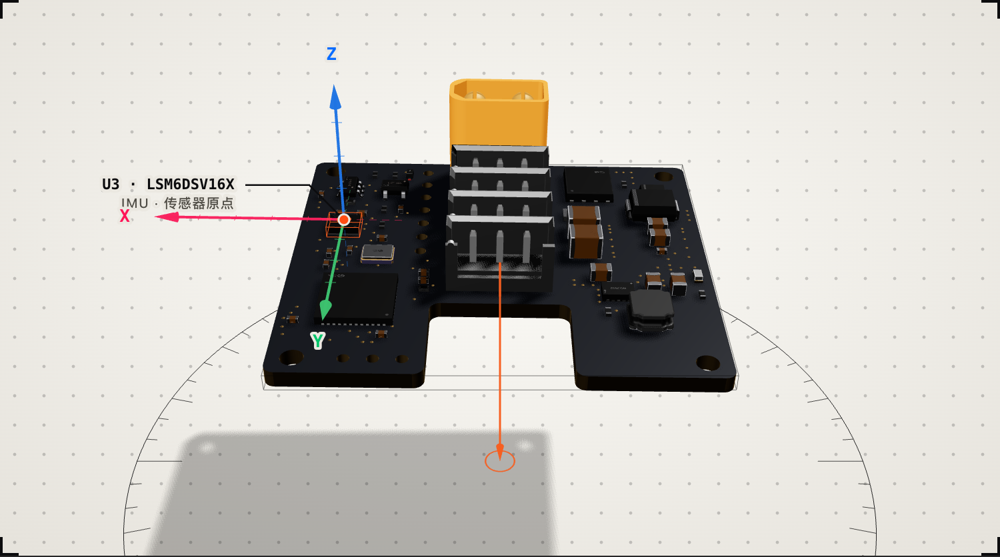
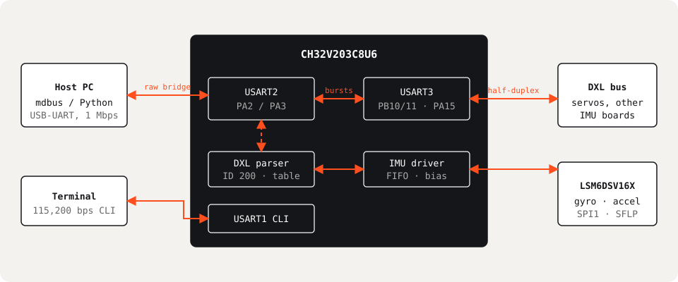

# dxl_imu_firmware

[English](README.md) · [简体中文](README.zh-CN.md)

    

DXL IMU/电源板固件：WCH CH32V203C8U6 加 ST LSM6DSV16X IMU，使用 Dynamixel Protocol 2.0。它在 Dynamixel
总线上输出陀螺仪角速度和片上传感器融合得到的姿态，并把一路 USB-UART 桥接到该总线。

<p align="center"></p>

## 功能

- Dynamixel Protocol 2.0 设备（默认 ID 200，1 Mbps）；地址 124 为 IMU 样本：陀螺仪（int16 ×3）和 SFLP
  四元数（半精度 ×3）。
- 陀螺仪量程、加速度计量程、传感器速率和融合速率可通过总线配置并保存到 Flash。
- 诊断块；双槽持久化配置（ID、波特率、IMU 参数）。
- 原始软总线：USART2 上的 USB-UART 原样桥接到真实 DXL 总线，总线流量回传给它，板子自己的 ID 也在同一条线上
  可访问。
- USART1 提供 115,200 bps 文本维护口，与软总线同时工作。
- 总线固件升级：引导程序加两个应用槽，新固件经校验、试运行并由自己确认；升级失败自动回到旧版本
  （[docs/ota.md](docs/ota.md)，英文）。

## 状态

<p align="center"></p>

| | |
|---|---|
| 版本 | `0x0210`（引导程序 `0x0100`）；上一发布 `0x020B`（标签 `firmware-20261006-0x020b`） |
| MCU / IMU | CH32V203C8U6（8 MHz 晶振）/ LSM6DSV16X |
| 默认值 | ID 200，1,000,000 bps；±500 dps、±2 g、240 Hz |
| 软总线 | USART2，PA2（TX）/ PA3（RX），1,000,000 bps 8N1 |
| 文本 CLI | USART1，PA9（TX）/ PA10（RX），115,200 bps 8N1 |
| 宿主机测试 | 8/8 通过 |

已经测过什么、没有测过什么：[docs/validation.md](docs/validation.md)（英文）。

## 通过总线升级固件

用 SWD 一次性写入引导程序和槽 A 之后，新固件通过 DXL 总线写入：

```bash
scripts/build-ota.sh                                      # build-ota/dxl_imu_firmware-<版本>.dxlfw、initial.bin
wlink flash --address 0x08000000 build-ota/initial.bin    # 仅一次
hdbus ota update -p /dev/cu.usbserial-XXXX build-ota/dxl_imu_firmware-0210.dxlfw
```

`hdbus` 的网页界面有"固件"页，可以做同样的事。分区、协议和安全措施见 [docs/ota.md](docs/ota.md)（英文）。

## 构建

Windows 构建使用官方 [MounRiver Studio 2](https://www.mounriver.com/download) 自带的编译器（WCH RISC-V
GCC 8.2.0）。WCH SDK 已包含在仓库中，不需要下载任何东西。

```powershell
powershell -NoProfile -ExecutionPolicy Bypass -File .\build.ps1
# IDE 安装在其他目录时：
powershell -NoProfile -ExecutionPolicy Bypass -File .\build.ps1 -MounRiverRoot 'D:\Tools\MounRiver_Studio2'
```

产物在 `build-ch32/`：`imu_power_ch32.elf`、`.hex`、`.bin`、`.map`。应用区限制为 56 KiB，末尾两个 4 KiB
Flash 页用于保存配置。

macOS 或 Linux 上，用 [xPack](https://github.com/xpack-dev-tools/riscv-none-elf-gcc-xpack/releases) 的
`riscv-none-elf-gcc`（放入 `PATH`）编译同一份源码：

```bash
scripts/build-xpack.sh        # 产物在 build-xpack/
```

xPack 构建不是基准工具链：0x020B 固件用它在硬件上验证过，0x020B 发布版也由它构建；0x020A 及以前的发布版使用
MounRiver 编译器构建。

宿主机测试（C99 编译器和 CMake 3.16 及以上，不需要 MCU 工具链）：

```bash
cmake -S . -B build-host
cmake --build build-host
ctest --test-dir build-host --output-on-failure
python3 tools/dxl_softbus_tool.py self-test
```

## 烧录

使用 WCH-LinkE 和 [`wlink`](https://github.com/ch32-rs/wlink)：

```bash
wlink flash --address 0x08000000 build-ch32/imu_power_ch32.bin
wlink reset
```

- 有读保护的芯片要先解锁（`wlink unprotect`）。这会擦除整片芯片，包括配置页，普通升级不要使用。
- `wlink status` 和 `wlink dump` 会让 MCU 停住，用完要执行 `wlink reset`；串口测量前请断开调试器（调试器连接
  时会改变目标时钟）。

## 使用

- `hdbus`：实时姿态和陀螺仪、IMU 设置、ID 与波特率、总线扫描。
- [`tools/dxl_softbus_tool.py`](docs/tools.md)：IMU 检查、总线扫描、舵机配置。
- 需要支持 1 Mbps 的 USB-UART（FTDI 可以，WCH-LinkE 自带串口不行），接到 PA2/PA3 和 GND。

## 文档

文档（除本 README 外）为英文。

| | |
|---|---|
| [docs/control-table.md](docs/control-table.md) | 寄存器表、维护命令、IMU 参数、文本 CLI |
| [docs/architecture.md](docs/architecture.md) | 硬件、源码结构、软总线、数据通路、Flash 布局、构建 |
| [docs/tools.md](docs/tools.md) | `dxl_softbus_tool.py` |
| [docs/validation.md](docs/validation.md) | 验证记录 |
| [docs/ota.md](docs/ota.md) | 总线固件升级：分区、引导程序、协议、安全措施 |
| [CHANGELOG.md](CHANGELOG.md) | 版本历史 |
| [THIRD_PARTY.md](THIRD_PARTY.md) | 第三方代码与许可 |

## 仓库结构

```text
include/imu_power/  可移植接口            src/      可移植核心
platform/           CH32V203 适配         tests/    宿主机测试
bootloader/         A/B 槽引导程序        tools/    软总线工具、升级打包
scripts/            xPack 构建            docs/     文档
vendor/             固定版本 WCH SDK
```

## 许可

Apache License 2.0，见 [LICENSE](LICENSE)。`vendor/` 下的 WCH SDK 等第三方内容保留各自的声明，见
[THIRD_PARTY.md](THIRD_PARTY.md)。
